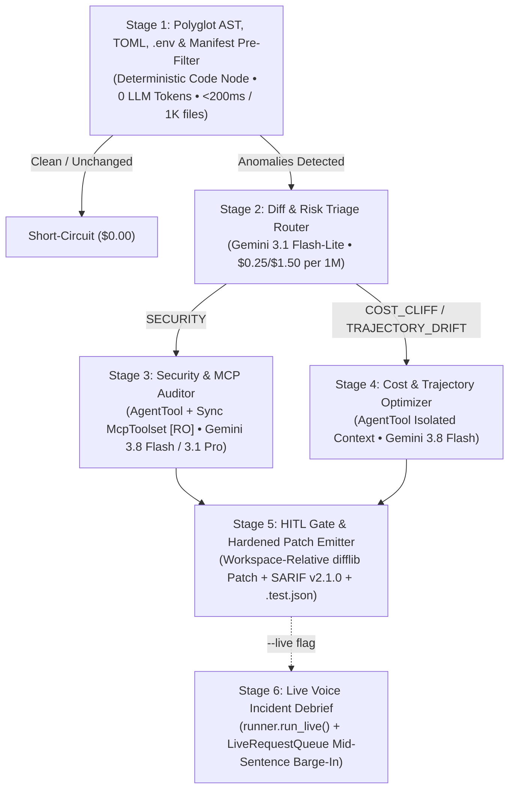

# MCPGuard-ADK
 
**Open-source multi-agent Model Context Protocol (MCP) supply-chain, secret-leak, >200K token cost-cliff, and tool-trajectory auditor engineered on Google Agent Development Kit (ADK) 2.0, Agent2Agent (A2A) Protocol v1.0, and OpenTelemetry.**

[](https://github.com/Chitresh-Bhatia-264/MCPGuard-ADK/actions)


```text
━━━━━━━━━━━━━━━━━━━━━━━━━━━━━━━━━━━━━━━━━━━━━━━━━━━━━━━━━━━━━━━━━━━━━━━━━━━━━━━━━━━━━━━━━━━━━━━━
   ▄████▄    ███╗   ███╗ ██████╗██████╗  ██████╗ ██╗   ██╗ █████╗ ██████╗ ██████╗ 
  ██╔═══╝    ████╗ ████║██╔════╝██╔══██╗██╔════╝ ██║   ██║██╔══██╗██╔══██╗██╔══██╗
  ██║  ███╗  ██╔████╔██║██║     ██████╔╝██║  ███╗██║   ██║███████║██████╔╝██║  ██║
  ██║   ██║  ██║╚██╔╝██║██║     ██╔═══╝ ██║   ██║██║   ██║██╔══██║██╔══██╗██║  ██║
  ╚██████╔╝  ██║ ╚═╝ ██║╚██████╗██║     ╚██████╔╝╚██████╔╝██║  ██║██║  ██║██████╔╝
   ✦ ADK 2    ╚═╝     ╚═╝ ╚═════╝╚═╝      ╚═════╝  ╚═════╝ ╚═╝  ╚═╝╚═╝  ╚═╝╚═════╝ 
   Google ADK 2.0 Hybrid Graph • A2A v1.0 Ed25519/JCS • Gemini FinOps • Cloud Trace OTLP v0.3.0
━━━━━━━━━━━━━━━━━━━━━━━━━━━━━━━━━━━━━━━━━━━━━━━━━━━━━━━━━━━━━━━━━━━━━━━━━━━━━━━━━━━━━━━━━━━━━━━━

╭─ ✦ 0-TOK AST ──────╮  ╭─ ◆ RISK ALERTS ────╮  ╭─ ● FINOPS SAVED ───╮  ╭─ ▸ A2A v1.0 JWS ───╮
│ 1053/1069 Clean    │  │ 23 Findings        │  │ -95.4% Spend       │  │ Ed25519 OK         │
│ $0.00 (0 Tokens)   │  │ 11 Crit • 11 High  │  │ $52.15 vs $1,144   │  │ ID 853af5cf368     │
╰────────────────────╯  ╰────────────────────╯  ╰────────────────────╯  ╰────────────────────╯

╭── ◆ Security & >200K Cost-Cliff Alerts (Auto-Redacted Pinpoint View) ───── ACTION REQUIRED ──╮
│  4.  CRITICAL  MCPG-SEC-003 ▸ vulnerable_mcp_config.json:11:41                               │
│     WHAT LEAKED : GitHub Personal Access Token: GITHUB_PERSONAL_ACCESS_TOKEN = ghp_1234••••  │
│     WHERE (FILE): examples/vulnerable_mcp_config.json (Line 11, Col 41)                      │
│     ┌── Source Pinpoint ──────────────────────────────────────────────────────────────────   │
│     │   10 │       "env": {                                                                  │
│     │   11 │         "GITHUB_PERSONAL_ACCESS_TOKEN": "ghp_1234••••••••••••••••••••••••••••1  │
│     │      │                                         ^^^^^^^^^^^^^^^^^^^^^^^^^^^^^^^^^^^^^^  │
│     │   12 │       },                                                                        │
│     └─────────────────────────────────────────────────────────────────────────────────────   │
│     ✔ FIX: Replace literal value with `${GITHUB_PERSONAL_ACCESS_TOKEN}` and load from `.env` │
╰──────────────────────────────────────────────────────────────────────────────────────────────╯

╭── ✦ Google Cloud & ADK 2.0 Verification Scorecard (5/5) ───────────────────  100% VERIFIED  ─╮
│ ✔ [VERIFIED] ADK 2.0 Hybrid Graph     │ Skipped 1053 clean files locally at $0.00 (0 tokens) │
│ ✔ [VERIFIED] Zero Context Bloat       │ Sync McpToolset isolated in AgentTool (read-only)    │
│ ✔ [VERIFIED] A2A v1.0 Ed25519 + JCS   │ RFC 8037 EdDSA verified over RFC 8785 JCS AgentCard  │
│ ✔ [VERIFIED] Cloud Trace OTLP SDK     │ EVENT_ONLY active; W3C resourceSpans exported        │
│ ✔ [VERIFIED] MCP Stdio & SARIF Gate   │ JSON-RPC 2.0 serve-mcp + SARIF v2.1.0 + .test.json   │
╰──────────────────────────────────────────────────────────────────────────────────────────────╯
```

---

## 30-Second Quickstart (`$0` Offline Scan — No API Key Required)

Run directly with **`uvx`** / **`pip`** on **Python 3.11+**, or install from source:

```bash
# Option A: Zero-install one-liner via uvx / pip (once published on PyPI, or directly from GitHub)
uvx --from git+https://github.com/Chitresh-Bhatia-264/MCPGuard-ADK mcpguard scan .
# (After PyPI release: `pip install mcpguard-adk` or `uvx mcpguard-adk scan .`)

# Option B: Clone & run the built-in vulnerable examples + interactive shell
git clone https://github.com/Chitresh-Bhatia-264/MCPGuard-ADK.git
cd MCPGuard-ADK
pip install -e ".[dev]"
python -m mcpguard_adk.cli scan ./examples --live
python -m mcpguard_adk.cli shell
```

---

## Why MCPGuard-ADK?

Enterprise AI agent deployments hit two walls before production:
1. **Security / AppSec**: Over-broad MCP servers (`"/"` host mounts, unpinned `npx -y` execution, plaintext API keys in `mcp.json` or `.env`, prompt-injection payloads in tool metadata, and client-side XSS sinks).
2. **FinOps / Token Cost Cliffs**: Connecting `McpToolset` directly to a root orchestrator dumps 20+ tool schemas and raw file reads into global context—pushing uncompacted loops across **Gemini 3.1 Pro's 200,000-token pricing cliff** (`$2.00` $\rightarrow$ `$4.00`/1M input, `$12.00` $\rightarrow$ `$18.00`/1M output).

**MCPGuard-ADK** solves both in a single CI/CD gate using a **6-stage Google ADK 2.0 Hybrid Graph**:



---

## Built-In Detection Rules (Stage 1 Zero-Token Engine)

| Rule ID | Severity | Target Files | Vulnerability / Anti-Pattern Detected |
| :--- | :--- | :--- | :--- |
| `MCPG-SEC-001` | `CRITICAL` | `mcp.json`, `claude_desktop_config.json` | Over-broad host filesystem scope (`"/"`, `"~"`, `"C:\"`, `".."`, `"/etc"`). |
| `MCPG-SEC-002` | `HIGH` | `mcp.json`, `*mcp*.json` | Unpinned `npx -y` / `uvx` / `bunx` remote package execution without version lock. |
| `MCPG-SEC-003` | `CRITICAL` | `mcp.json`, `.env*`, `.py`, `.ts`, `.tsx`, `.js` | Leaked credentials (`AIza...` Gemini/GCP, `ghp_...` GitHub, `sk-...` OpenAI/Anthropic, `AKIA...` AWS, `sk_live_...` Stripe, DB URIs) with screen-safe masking. |
| `MCPG-SEC-004` | `CRITICAL` / `HIGH` | `mcp.json`, `.tsx`, `.jsx`, `.ts`, `.js` | Indirect prompt-injection payloads in MCP metadata & unescaped `dangerouslySetInnerHTML` / `eval()` sinks. |
| `MCPG-SEC-005` | `MEDIUM` | `mcp.json` | Missing read-only `tool_filter` on filesystem/shell MCP servers. |
| `MCPG-ADK-001` | `HIGH` | `.py` (Python AST) | Asynchronous runtime initialization of `McpToolset` inside `async def` (violates ADK session recovery rule). |
| `MCPG-ADK-002` | `HIGH` | `.py` (Python AST) | `McpToolset` instantiated without explicit least-privilege `tool_filter`. |
| `MCPG-ADK-003` | `MEDIUM` | `.py` (Python AST) | `McpToolset` bound directly to root agent instead of isolated `AgentTool` sub-agent. |
| `MCPG-ADK-004` | `HIGH` | `.py` (Python AST) | `LlmAgent` binding `>20` tools directly (schema bloat & tool-selection degradation). |
| `MCPG-COST-001` | `HIGH` | `.py` (Python AST) | Uncompacted `for`/`while` loops on Pro-tier models liable to cross the `>200K` token 2x pricing cliff. |
| `MCPG-PKG-001..003` | `HIGH` / `MEDIUM` | `package.json`, `pyproject.toml`, `go.mod` | Wildcard (`*`, `latest`), insecure `http://`, or local `replace => ../` supply-chain overrides. |

---

## Late-2026 Gemini Rate-Card & Cost-Cliff Benchmark

| Architecture Pattern | Assumed Workload per PR Audit | Published Rate Card Applied (per 1M Tokens) | Transparent Per-PR Math | Cost per 1,000 PR Audits |
| :--- | :--- | :--- | :--- | :--- |
| **Naive Single-Agent Loop (>200K Cliff)** | Uncompacted context reaches 250K in, 8K out on Gemini 3.1 Pro Preview | `$4.00` input / `$18.00` output (>200K tier) | `(0.25 * $4.00) + (0.008 * $18.00) = $1.144` | **`$1,144.00`** |
| **Naive Single-Agent Loop (<=200K)** | Compaction holds context at 120K in, 8K out on Gemini 3.1 Pro Preview | `$2.00` input / `$12.00` output (<=200K tier) | `(0.12 * $2.00) + (0.008 * $12.00) = $0.336` | **`$336.00`** |
| **MCPGuard-ADK Tiered Hybrid (2026 Promo)** | Stage 1 skips clean files (0 tokens); 3.1 Flash-Lite triage (40K in / 2K out); 3.8 Flash audit (25K in / 4K out); 3.1 Pro escalation on 10% of PRs | 3.1 Flash-Lite: `$0.25`/`$1.50`; 3.8 Flash: `$0.75`/`$3.75`; 3.1 Pro: `$2.00`/`$12.00` | `$0.013 + $0.03375 + $0.0054 = $0.05215` | **`$52.15`** *(95.4% lower)* |
| **MCPGuard-ADK Async Batch (2027 Post-Promo)** | Overnight Batch API (50% off Standard; 3.8 Flash at `$1.50`/`$7.50` list rate) | Batch: 3.1 Flash-Lite `$0.125`/`$0.75`; 3.8 Flash `$0.75`/`$3.75`; 3.1 Pro `$1.00`/`$6.00` | `$0.0065 + $0.03375 + $0.0027 = $0.04295` | **`$42.95`** |

Reproduce these calculations via CLI:
```bash
python -m mcpguard_adk.cli cost-sim --prs 1000
```

---

## IDE Integration (MCP Stdio Server) & A2A Protocol v1.0

### 1. Mount Inside Cursor, Claude Desktop, VS Code, or Gemini CLI (`mcp.json`)
```json
{
  "mcpServers": {
    "mcpguard-adk": {
      "command": "python",
      "args": ["-m", "mcpguard_adk.cli", "serve-mcp"]
    }
  }
}
```
Exposes `mcpguard_audit_repository`, `mcpguard_simulate_cost_cliff`, and `mcpguard_verify_agent_card` over JSON-RPC 2.0 stdio (supporting both newline-delimited and `Content-Length` framing).

### 2. 1-Click GitHub Pull Request Bot (Composite GitHub Action)
Add `.github/workflows/mcpguard.yml` to any repository—whenever a teammate modifies `mcp.json`, `.env`, React/TS, or an ADK agent, **MCPGuard-ADK** posts **1-click inline `suggestion` commits** and blocks critical leaks:

```yaml
name: MCPGuard-ADK PR Bot
on: [pull_request]
permissions:
  contents: read
  pull-requests: write
  issues: write
jobs:
  audit:
    runs-on: ubuntu-latest
    steps:
      - uses: actions/checkout@v4
        with:
          fetch-depth: 0
      - uses: Chitresh-Bhatia-264/MCPGuard-ADK@main
        with:
          github-token: ${{ secrets.GITHUB_TOKEN }}
          fail-on: "critical"
```

### 3. Cross-Framework A2A Protocol v1.0 Server (`Ed25519` + `RFC 8785 JCS`)
```bash
# Start HTTP+JSON and Server-Sent Events (SSE) A2A v1.0 endpoint
python -m mcpguard_adk.cli serve-a2a --host 127.0.0.1 --port 8080

# Inspect & cryptographically verify the EdDSA-signed AgentCard + RFC 8037 OKP JWKS
python -m mcpguard_adk.cli agent-card --jwks
```
- Publishes `GET /.well-known/agent-card.json` signed with asymmetric **Ed25519 (`EdDSA`, RFC 8037)** over **RFC 8785 JSON Canonicalization Scheme (JCS)** and public keys at `GET /.well-known/jwks.json`.
- Streams `TaskStatusUpdateEvent` and chunked `TaskArtifactUpdateEvent` (`append` & `lastChunk`) using unified A2A v1.0 `Part` member `oneof` payloads.
- Protects `TaskPushNotificationConfig` webhooks against private-IP/cloud-metadata SSRF (`169.254.169.254`, `metadata.google.internal`) and JWT `jti` replay attacks.

---

## CLI Command Reference & CI/CD Gating

```bash
# Interactive slash-command shell (/scan, /react, /voice, /patch, /a2a, /quit)
python -m mcpguard_adk.cli shell

# Full scan + approve Stage 5 HITL gate + emit SARIF v2.1.0 + export W3C OTLP traces
python -m mcpguard_adk.cli scan ./examples --live --approve-patches \
  --emit-sarif reports/mcpguard.sarif.json \
  --export-otel reports/otel_traces.json

# Pull-Request CI Gate (scan only git-modified files; exit code 2 on CRITICAL/HIGH)
python -m mcpguard_adk.cli scan . --git-diff --fail-on high

# Generate or post 1-Click GitHub PR Inline Review Suggestions (```suggestion blocks)
python -m mcpguard_adk.cli pr-review . --git-diff --fail-on critical

# Launch interactive browser visualizer (ADK 2.0 Graph + >200K Cliff Sliders)
python -m mcpguard_adk.cli ui ./examples

# Run the 17-test verification suite (AST, FinOps, Ed25519 tamper detection, MCP stdio, OTel)
python -m pytest tests -v
```

---

## Repository Structure

```text
MCPGuard-ADK/
├── mcpguard_adk/
│   ├── agent.py                  # ADK 2.0 Hybrid Graph, sync McpToolset, AgentTool & native ADK bridge
│   ├── cli.py                    # CLI entrypoints (scan, shell, serve-mcp, serve-a2a, ui, agent-card, cost-sim)
│   ├── cost_engine.py            # Late-2026 Gemini rate-card, >200K Pro cliff & cache storage ROI math
│   ├── llm_client.py             # Official google-genai SDK client with 0-cost offline fallback
│   ├── mcp_server.py             # Spec-compliant JSON-RPC 2.0 MCP stdio server
│   ├── sarif.py                  # SARIF v2.1.0 exporter for GitHub Advanced Security
│   ├── tui.py                    # 24-bit TrueColor terminal dashboard, secret redaction & REPL shell
│   ├── web_studio.py             # Interactive browser graph & FinOps studio
│   ├── a2a/                      # A2A v1.0 Ed25519/JCS signer, JWKS verifier, SSE & SSRF/jti guards
│   ├── agents/                   # Security auditor, FinOps optimizer & Live Voice barge-in debrief
│   ├── nodes/                    # Stage 1 AST/TOML/.env pre-filter, Stage 2 router & Stage 5 difflib patcher
│   └── telemetry/                # Official OpenTelemetry SDK W3C tracer & OTLP/JSON exporter (EVENT_ONLY)
├── examples/                     # Deliberately vulnerable MCP config & uncompacted Pro loop for testing
├── evals/                        # ADK .test.json and multi-turn .evalset.json conformance suites
├── tests/                        # 17 automated pytest suites
├── Dockerfile                    # Production container for Google Cloud Run
└── cloudbuild.yaml               # Automated Google Cloud Build CI/CD pipeline
```

---


## License & Contributing

- **License**: [Apache License 2.0](LICENSE)
- **Contributing & Good First Issues**: [`CONTRIBUTING.md`](CONTRIBUTING.md) • [`.github/ISSUE_TEMPLATE/good_first_issue.md`](.github/ISSUE_TEMPLATE/good_first_issue.md)
- **AI Code Editor Index**: [`llms.txt`](llms.txt)

*If MCPGuard-ADK caught a misconfiguration or saved token spend, a star helps others discover it.*
